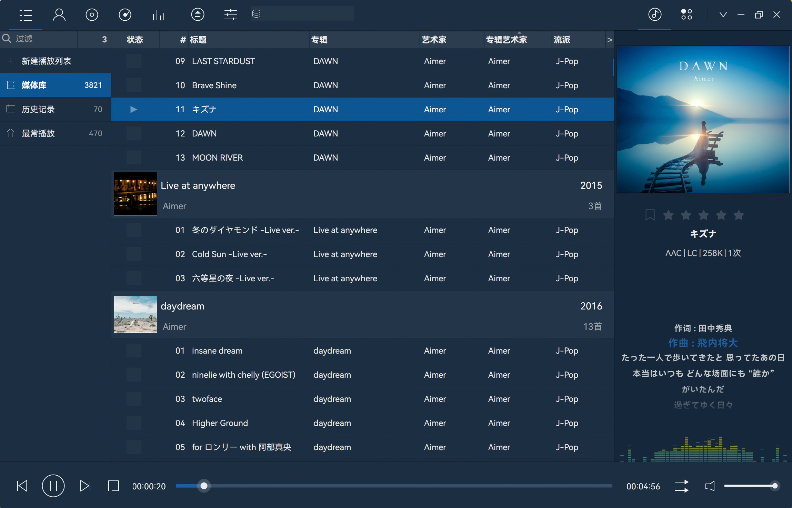
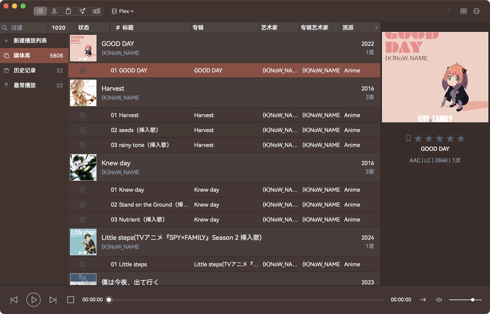
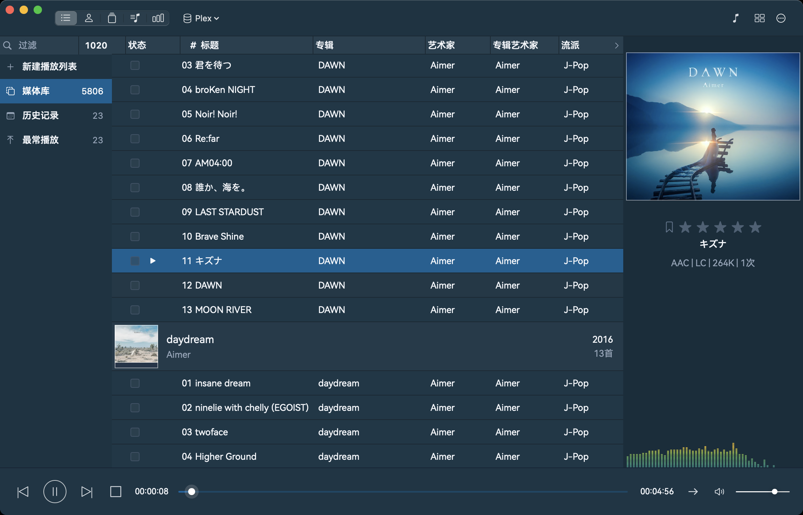
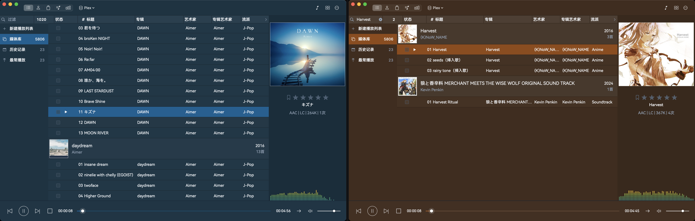
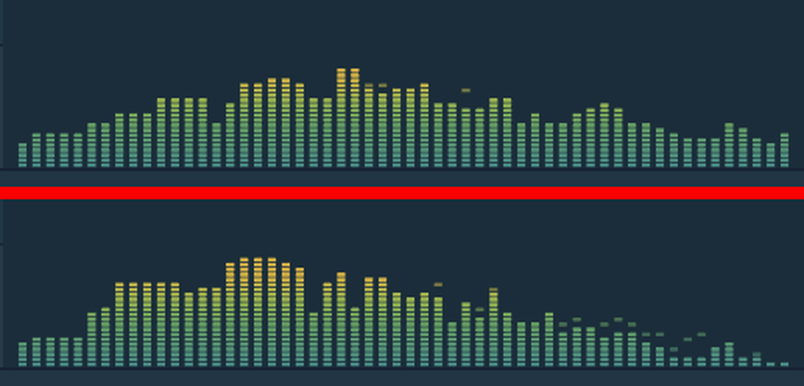

# 音乐 — 极简音乐播放器

一个为 macOS 写的**极简音乐播放器**，灵感来自 **Foobar2000**（dream7180 的美化版皮肤）。

> 小体积、高性能、好看。

- **小体积**：整个 App 4.2 MB（可执行文件 2.4 MB，安装包 2.5 MB），没有 Electron、没有跨平台 UI 框架，纯 SwiftUI + AVFoundation。
- **高性能**：5,806 首的库**首次扫描 4.2 秒**、之后按 `⌘R` **0.3 秒**；表格用 AppKit `NSTableView` 复用单元格，滚到列表最底部内存也不涨（318–328 MB 之间持平）；播放时整进程 CPU 约 14%，静置 0%。
- **好看**：整体配色跟着当前曲目的封面走，窗口是半透明材质（背景模糊/透明度可调），右下角是**真的对音频做 FFT** 的 LED 频谱，不是装饰动画。

## 已经做到的功能

| | 能力 |
| --- | --- |
| 资料库 | 导入文件夹（`⌘O`）递归扫描；读标题/艺术家/专辑/专辑艺术家/流派/曲目号/碟号/年份/内嵌封面；无标签时用文件名兜底；多碟专辑按「碟-轨」排（`2-03`） |
| 缓存 | 扫描结果与封面落盘缓存，冷启动直接命中（0.7 秒出窗口）；按 mtime + 大小做增量，重扫只解析变过的文件 |
| 浏览 | 5 种视图（播放列表/艺术家/专辑/流派/播放统计）、列头三态排序（升/降/取消）、过滤框实时筛选、专辑分组头 |
| 播放 | AVAudioPlayer 真播；进度拖动、上/下一首、停止、顺序/列表循环/单曲循环/随机、音量（默认 100%，上限 100%） |
| 会话 | 退出记住曲目与播放位置，重开接着放；音量与播放模式各自持久化 |
| 队列 | 播放列表（新建/添加曲目/删除）、跟随播放自动滚动、定位到当前播放 |
| 显示 | 配色跟随封面、背景模糊与透明度滑块、真实频谱、半透明窗口材质 |
| 交互 | 星级评分、勾选、右键菜单、拖放窗口、全键盘菜单项（`⌘O` / `⌘R` / 空格 / `⌘→` / `⇧⌘M`） |
| 工程 | 22 项无窗口自检（`--self-test`）、资源包定位自检（`--resource-check`）、离屏渲染（`--render-ui` 等）、打包脚本与 DMG |

## 还没做的

- **歌词展示（待补充）**：右侧面板现在能显示歌词，但只有内置示例库带歌词；**真实文件的歌词还没接**——既没读 `.lrc` 同名文件，也没读内嵌歌词，更没有逐行高亮/滚动。这是下一项要补的。
- 没有播放列表导入导出（`.m3u`）、没有 AirPlay、没有全局媒体键与「正在播放」控制中心集成。






## 系统要求

- macOS 14 (Sonoma) 及以上
- 构建需要 Xcode 命令行工具（Swift 5.9+）

## 构建与运行

```bash
./build.sh                 # swift build -c release + 组装 .app
open build/音乐.app
```

`build.sh` 会生成 `build/音乐.app`（ad-hoc 签名，可直接双击运行，图标见 `Resources/AppIcon.icns`）。

应用图标：原图在 `Assets/appicon-source-mockup.jpg`（一张带有「Music Player」版式的效果图），由 `tools/make-appicon.py` 排版成 `Resources/AppIcon.icns`。效果图里的图标带拍摄背景和投影，脚本用超椭圆（n=5）沿图标的圆角边缘切开、抠掉背景，再按 macOS 图标网格把圆角矩形重排到画布 **83%**（系统 App 实测 82.8%），最后生成 16/32/64/128/256/512/1024 共 10 个尺寸——缩放走预乘 alpha，小尺寸不会出现白边。用效果图里的图标时只要给一条命令：`python3 tools/make-appicon.py 效果图.jpg --crop x,y,边长`。

## 打包成 DMG

```bash
./tools/make-dmg.sh          # → build/音乐-<版本>.dmg（约 4 MB）
```

- **只出 arm64**：`swift build -c release` 的默认目标就是本机架构，`lipo -info` 只会看到 `arm64`。这个项目不做 Intel 兼容，也不接受 universal 二进制。
- **ad-hoc 签名**：这台机器没有 Developer ID，所以 App 是 ad-hoc 签的（`codesign -v --deep --strict` 能过，但没有公证）。拷到另一台 Mac 后 macOS 会拦一次，DMG 里带了：
  - `首次打开.command`：双击后执行 `xattr -dr com.apple.quarantine`，之后就能正常双击启动；
  - `请先看我.txt`：同样的说明，加使用提示。
- DMG 里还有一个指向 `/Applications` 的快捷方式，拖过去即可。
- **首次启动是空资料库**：中间给一张「资料库里还没有音乐」的引导卡片（选文件夹 / 载入示例资料库）。示例资料库只是用来对照参考截图，里面的曲目**没有音频文件**，所以不会自动加载；要用就在引导卡片、或顶栏资料库来源菜单（`Plex ⌄` 那个）里点「载入示例资料库」，此时右侧面板会标一行「示例曲目 · 没有音频文件」。
- `⌘O` 导入自己的音乐后会把扫描结果缓存到 `~/Library/Application Support/local.aria.music/`，下次启动直接命中，不再重扫。
- 目标平台是 macOS 14+ / Apple 芯片。Intel Mac 装不上——没有 x86_64 切片，这是刻意的。

## 界面

| 区域 | 内容 |
| --- | --- |
| 顶栏 | macOS 原生窗口外框：左侧系统红绿灯，中间分段控件切换 5 种视图，右侧资料库来源菜单与「定位到当前播放 / 更多操作」两个工具栏按钮 |
| 左侧栏 | 新建播放列表、媒体库、历史记录、最常播放，右侧对齐显示条目数，选中行整行高亮 |
| 主表格 | 过滤框 + 列头（状态、# 标题、专辑、艺术家、专辑艺术家、流派），按专辑分组显示专辑头（封面缩略图、专辑名、艺术家、年份、曲目数）与曲目行。封面按显示尺寸（124px）直接解码，并预热首屏，滚动时不再出现空白占位 |
| 右侧面板 | 专辑封面、书签、五星评分、曲名、格式信息（AAC \| LC \| 258K \| 播放次数）、作词作曲、歌词、实时频谱 |
| 底部 | 上一首、播放/暂停、下一首、停止、已播放时间、进度条、总时长、随机播放、音量 |

## 功能

- **示例资料库**：手动加载后就是截图里的 Aimer 三张专辑（DAWN / Live at anywhere / daydream），可以直接体验切歌、评分、勾选等交互（曲目没有音频，不能真的出声）。
- **导入真实音乐**：`⌘O` 选择文件夹后递归扫描音频文件，读取标题 / 艺术家 / 专辑 / 专辑艺术家 / 流派 / 曲目号 / 碟号 / 年份 / 内嵌封面，没有标签信息时用文件名回退解析。曲目边扫边出现（每 250 首刷新一次），不会出现长时间空表。**5,806 首实测：首次 4.2 秒**（8 路并发读标签），**再按 `⌘R` 只花 0.3 秒**（5,806/5,806 个文件按 mtime + 大小判为未变，直接复用上次的解析结果，一次标签都不读）。
- **播放**：AVAudioPlayer 播放真实文件，示例曲目用模拟时钟；支持进度拖动、音量拖动、随机、循环（off / all / one）。
- **播放历史 / 最常播放**：按播放次数自动排序，`notePlay` 在开始播放时累计。
- **评分与勾选**：右侧面板点星修改评分，表格状态列可勾选曲目。
- **无窗口自检**：`--self-test` 一次跑完扫描、封面、播放、暂停等 22 项检查，终端里给出 PASS / FAIL；可以带一个文件夹参数（`--self-test /path/to/music`），默认用 `~/Music/Plex`，**该目录不存在时自动写一批 6 秒的合成 WAV 当测试夹具**，所以换台机器也能跑满。
- **原生窗口外框**：用系统红绿灯、`Picker(.segmented)` 视图切换、标准下拉菜单与 SF Symbols 工具栏按钮，窗口标题栏透明、内容延伸到顶部；拖动窗口靠 `isMovableByWindowBackground`。
- **自绘矢量图标（仅底部播放控制）**：上一首 / 播放 / 下一首 / 停止 / 播放模式仍用 SwiftUI `Canvas` 按参考图手写路径绘制（`Views/SkinIcons.swift`，约 170 行），线宽随缩放保持恒定，配合参考图里 32pt 圆环、3px 轨道的规格。

## 顶栏都做什么

参考截图来自一个 Windows 播放器（foobar2000 + foobox 皮肤）：48pt 图标 tab、常驻的蓝色下划线、伪装的资料库胶囊、以及右侧三个手绘窗口按钮。这些在 macOS 上都不成立，所以顶栏按 macOS 重做了——**其余部分（表格、侧栏、右面板、底部播放条）仍按参考图 1:1 还原**。

| 位置 | 控件 | 行为 |
| --- | --- | --- |
| 左上 | 系统红绿灯 | 关闭 / 最小化 / 缩放，由 AppKit 绘制（窗口标题栏隐藏，内容延伸到顶部） |
| 左 | 分段控件（5 段） | 播放列表 / 艺术家 / 专辑 / 流派 / 播放统计；切到「历史记录」「最常播放」时五段都不选中 |
| 中 | 资料库来源菜单 | 显示当前来源（如 `Plex`），菜单里是导入文件夹…（⌘O）/ 载入示例资料库 / 移除已导入的资料库 |
| 右 | ♪ 定位到当前播放 | 选中正在播放的曲目并把它滚到可视区 |
| 右 | ⋯ | 背景模糊 / 背景透明度滑块、背景是否用封面、跟随播放滚动 |

## 播放模式

底部 transport 右侧那个按钮（原先是随机图标的位置）就是播放模式开关，点一下循环切换四种：

| 图标 | 模式 | 放到最后一首时 | 上一首 / 下一首 |
| --- | --- | --- | --- |
| → | 顺序播放 | 停住（曲目留在面板上、进度归零） | 按列表走，到头不回绕 |
| ↻ | 列表循环 | 回到第一首继续放 | 回绕 |
| ↻1 | 单曲循环 | 重放当前这首 | 始终留在当前这首 |
| ⇄ | 随机播放 | 随机挑一首 | 随机挑一首，不会连续重复同一首 |

- 顺序播放用普通描边色，另外三种是蓝色（`Theme.accent`），一眼能看出「现在不是顺序播放」。
- 悬停有 tooltip 说明当前模式和行为；右键弹出四项菜单可直接跳选。
- 菜单栏「播放 → 播放模式」里有同样的四项（带勾），`⇧⌘M` 直接切换。
- 模式选择记在 `UserDefaults`（`player.playMode`），重开 App 还是上次那个。
- **一首播完自动接下一首**：由 `AVAudioPlayerDelegate.audioPlayerDidFinishPlaying` 触发（不是靠比较播放进度——`AVAudioPlayer` 放完会把 `currentTime` 归零，靠进度判断会永远等不到），`endHandled` 闸门保证一次结束只换一次曲，手动暂停不会被误判成播完。
- 顺序 / 列表循环 / 随机下切歌时，表格会自动滚动到新的播放行（「跟随播放滚动」可关）；选中行不跟着跳，方便你继续翻列表。

## 参考实现（foobox / foobar2000）规格

截图出自 Windows 上的 foobar2000 + foobox 皮肤。皮肤源码是可以直接读的：`themes/foobox/js_panels/*.js` 里每个面板都用 GDI 图元现画图标，几何和颜色都是写死的数字；`theme.fth`（二进制）里有明文的字体名和字段格式串。下面这些值从源码直接取，不是目测。

| 项目 | 源码里的值 | 本项目的落地 |
| --- | --- | --- |
| 字体 | `theme.fth`：HarmonyOS Sans SC；`zdpi = g_fsize / 12` | `Typo.face(_:_:)` 优先用 HarmonyOS Sans SC，未安装时回落系统字体 |
| 顶栏 tab | `imgw = 38*dpi`、`btn_space = 10*dpi`、`x_offset = 20*dpi`、下划线 3px 宽 `imgw + btn_space` | 仅作参考：顶栏已改成 macOS 原生分段控件，不再复刻这套 tab 条 |
| 播放键 | 36pt 画布，圆 `DrawEllipse(1,1,32,32,2)` → 直径 32pt、描边 1pt | 36pt 画布 + 33pt 圆 + 1pt 描边 |
| 上/下一首、停止 | 28pt 画布；三角 12×16pt；竖条 1pt；停止方框 15pt | `SkinGlyph.previous/next/stop` 按同比例换算到 24 单位设计盒 |
| 按钮间距 | `btn_space = floor(12*dpi) + 3` = 13.5pt | `Layout.controlSpacing = 13.5` |
| 进度条 | 轨 5px = 2.5pt；已播 `RGB(41,138,190)`；旋钮实心 10pt + 20pt 光晕（白 40/255） | 轨 2.5pt、`Theme.sliderFill`、旋钮 10pt + `glowInset 5` |
| 音量条 | 轨 3px = 1.5pt；旋钮实心 8pt + 16pt 光晕 | 轨 1.5pt、旋钮 8pt，轨用近白色（和进度条不同色） |
| 行高 | `cRow.default_playlist_h` 默认 35 | 35pt |
| 组头文字 | `GdiFont(g_fname, g_fsize + 4, 0)`，加粗版 `+3` | 15pt（正文 13pt + 2） |
| 组头底色 | `g_color_normal_txt & 0x09ffffff`（9% 白） | `Theme.albumHeaderBG` |
| 顶栏文字 | `RGB(236,236,236)`；按钮常态 `RGB(240,240,240)`、hover 白、按下 `RGB(200,200,200)` | `Theme.text` 与按钮 hover 变亮 |
| 配色来源 | `foobox.color.by.cover` 默认 true —— 整套配色由专辑封面推导 | 因此本项目直接按截图逐像素取色，而不是套固定主题 |

上面这张截图（`Assets/shot-playing.png`）就是 `--render-ui` 生成的离屏渲染，不是窗口截屏。

顺带说明两件事：皮肤图标不是图片资源（`icons/` 里只有 mp3/flac 之类的文件类型图标），全是 `topbar.js`/`bottombar.js` 里用 `Drawline`/`DrawEllipse`/`FillEllipse` 画的，所以只能照源码的坐标重画；配色随封面变化，说明参考截图的深蓝不是主题设定，而是 DAWN 这张封面的取色结果。

## 重启后恢复

关掉再打开，界面回到关掉时的样子：

- **上次播放的曲目与播放位置**：每次播放/暂停/拖动/退出都会把「曲目 + 播放到第几秒 + 播放模式」写进 `UserDefaults`（键 `player.resume.snapshot`，一段 300 字节左右的 JSON，含文件路径与专辑/艺术家/曲目号等匹配字段）。启动时按文件路径优先匹配，路径变了再退回「专辑 + 专辑艺术家 + 标题 + 曲目号」，所以整理文件夹之后也能接上。
- **音量默认 100%、上限 100%**：默认开满（和参考图一样旋钮贴在右端），滑杆拖到底就是 1.0，不会超过；你调过的值单独记在 `player.volume`，下次启动沿用。早期版本存过 0.72，用一个一次性迁移标记把它作废。
- 恢复出来是**暂停**状态，不会一开窗就出声 —— 面板、进度条、右侧封面都停在上次的位置，按下播放键从那里继续。
- 曲目靠 `Track.id` 不行：那个 UUID 每次启动都重生成，所以匹配用的是路径与元数据。
- 用 `--autoplay` 启动（截图/自检用）时跳过恢复，免得两个来源抢播放器。

## 配色取自封面

整套深蓝不是写死的主题色，而是从**当前播放曲目的专辑封面**里取样得到的 —— 这正是 foobar2000 皮肤 `foobox` 的 `foobox.color.by.cover`（默认开启）的行为，也是为什么参考截图是深蓝：DAWN 的封面就是深蓝。

- **取样**：把封面缩到 32×32，逐像素转 HSB；丢掉饱和度 < 0.18 的近灰像素（否则大片米白背景会把粉色封面平均成棕色），再把色相分成 24 个桶，取权重最大的桶并融入左右相邻桶做**圆形平均**（红/品红在 0°/360° 交界处不会平均成青色），得到色相与饱和度。
- **生成**：只把色相/饱和度套进一条固定的亮度阶梯 —— 窗口 0.26、行 0.28、列头 0.31、专辑头 0.29、右面板 0.23、底栏 0.27、分隔线 0.20、控件 0.33。亮度是照着参考截图量的，所以**换封面只换色调，文字对比度不变**。
- 选中行、强调色、进度条已播段、滑杆轨道也一起变色：面积大的表面饱和度封顶 0.60（选中行 0.92），保证再鲜的封面也不会把窗口刷成荧光色。
- DAWN 那张封面算出来就是参考截图里的深蓝（连续色阶差 ≤2），紫红封面算出来是酒红 —— 对照见 `Assets/compare-palette.png`。
- 切歌时 0.45s 缓动过渡；每个专辑的调色板按 albumKey 缓存，来回切歌不会重复取样。
- 没有封面、或示例库里没有封面的曲目，回退到参考截图的调色板 —— 也就是说 DAWN 那张封面算出来的颜色与参考图逐点相差在 2 个色阶内。

右下角的 **LED 频谱是真正对音频做分析得到的**，不是装饰动画：

- 每秒 30 次，从**当前播放位置**读 2048 个采样（同一个文件、同一帧），加 Hann 窗后用 vDSP 做实数 FFT。
- 1024 个频点按**对数**折叠成 56 个频段（40 Hz – 16 kHz，与音乐的听感刻度一致，不是线性均分）。
- 每个频段取峰值转 dB，映射到 0…1（-72 dB 为底、-20 dB 为顶，另加 8 dB 高频倾斜补偿），再做「快攻慢放」平滑 —— 和硬件电平表的观感一致。
- 56 根柱子按格子的绝对高度着色（teal → 绿 → 黄绿 → 琥珀），柱顶保留峰值小格。
- 内置示例库没有音频文件，所以示例曲目下频谱**保持静止**，不再拿一条假曲线糊弄。真实曲目才会动。
- 自检里用 440 Hz 与 6 kHz 正弦验证落点：440 Hz → 第 22 频段（444 Hz），6 kHz → 第 46 频段（5.8 kHz），静音输入全部归零。
- 上面 `Assets/spectrum-live.png` 是相隔 0.4 秒的两帧现场截图，柱形完全不同 —— 它是这段音乐当时的频谱，不是循环动画。



性能：分析跑在串行后台队列上、每秒 20 次，进度与电平分别放在独立的 `ObservableObject`（`ProgressClock` / `SpectrumBands` / `PlaybackCursor`）里，只有播放条和频谱条订阅高频更新；实测播放 256 kbps m4a 时整进程 CPU ≈14%（早前把它挂在 `PlayerEngine` 的 `@Published` 上、整窗 30 Hz 重绘时是 52.8%），静置为 0%。

## 多碟专辑：音轨号与顺序

多碟合辑（同一张专辑里 1–3 张 CD，每张 CD 的曲目号都从 01 重新开始）以前会全部挤在「碟 1」，于是列表里出现一串重复的 `01`：

- **根因**：iTunes 的 `trkn` / `disk` 是**二进制** atom（保留 2 字节 + 大端 UInt16 的「值、总数」），`AVMetadataItem` 不给它 `stringValue`。原来按字符串读，读到的永远是 nil，于是全部退回「碟 1、第 1 首」。
- **修法**：按二进制解析这两个 atom（`trck` / `tpos` 这种 ID3 风格字符串也还兼容）；文件名里的 `01 11 - 标题` 也按「碟号 + 音轨号」解释（`01 - 标题` 仍当作普通音轨号）。
- **显示**：专辑有多张碟时，`#` 列写成 `2-03`；单碟专辑仍是 `03`。排序键一直是「艺人 → 专辑 → 碟号 → 音轨号」，所以三张碟按 1、2、3 依次排下来。
- 缓存版本升到 2：旧缓存里存的碟号/音轨号是错的，升级后首次启动会自动重扫一次（不改变你已导入的文件夹与统计）。

## 背景通透度与模糊

窗口现在是一块半透明材质，后面铺着当前曲目的封面（高斯模糊）+ 调色板薄雾。两个滑块在顶栏右侧 `⋯` 里：

| 控件 | 范围 | 默认 | 作用 |
| --- | --- | --- | --- |
| 背景模糊 | 0–80 px | 26 px | 背后那张封面的高斯模糊半径；0 是清晰的原图 |
| 背景透明度 | 40%–100% | 94% | 各层表面的不透明度；100% 就是不透光的旧观感 |
| 背景显示专辑封面 | 开/关 | 开 | 关掉后退回调色板渐变 |

- 实现：`AppearanceSettings` 把两个值存进 `UserDefaults`（`appearance.backgroundOpacity` / `appearance.backgroundBlur`）；`Palette.washed(by:)` 统一给所有大块表面乘上 alpha——文字、选中行、强调色保持不透明，只有背景变透，所以调低不会牺牲可读性。
- 窗口本身改成 `isOpaque = false` + 透明背景，桌面（以及壁纸）在低透明度下会真的透进来。
- 封面是异步解码的，背景层自己持有 `@State`，封面到了会补上，不会一直空白。
- 命令行也能直接钉住某个观感，方便截图/复现：`open build/音乐.app --args --opacity 0.8 --blur 50`。

## 表格容器：为什么是 NSTableView

主表格跑在真正的 AppKit `NSTableView` 上（`Sources/MusicApp/Views/SongTableAppKit.swift`：`NSViewRepresentable` + `NSTableViewDataSource` + `NSTableCellView` 复用 + `NSHostingView` 承载现有行视图）。原因是**「越往下滚越卡」不是错觉**：

| 滚到列表的位置 | SwiftUI `LazyVStack` 常驻内存 | `NSTableView` 常驻内存 |
| --- | --- | --- |
| 顶部 | 319 MB | 325 MB |
| 中间（50%） | 403 MB | 328 MB |
| 底部（100%） | 493 MB | 318 MB |

同一份 5,806 首的资料库，只用 `--scroll-fraction` 跳到不同深度、不动其他东西。SwiftUI 的 `LazyVStack` **不回收**已经滚过去的行——每行的布局、缩略图、文本图层都还活着，滚得越远留下的越多，于是每滚一步要维持的东西也越多，手感就越差；`NSTableView` 复用单元格，三个深度的内存基本不变。

顶部测的时候两者 CPU 都是 24–29%，看不出差别——差别只在深度上出现。所以默认换成了 NSTableView，`--swiftui-table` 可以切回旧实现对照：

```bash
open build/音乐.app --args --swiftui-table        # 旧容器
open build/音乐.app --args --scroll-fraction 0.5  # 调试：直接跳到列表 50% 处
```

那条路上踩到的两个坑（已修）：view-based `NSTableView` 的 `scrollRowToVisible` 对自定义行高无效，改成手动 `contentView.scroll(to:)`；行视图用 `.task` 各自取缩略图，封面解码完成只重绘那一行，不再触发整表重建。

## 资料库缓存的写者

## 增量扫描

`⌘R` 不再整份重扫。扫描时枚举器顺带取每个文件的 `contentModificationDate` 和大小，与快照里同路径曲目的 `fileMtime` / `fileSize` 比对：

- **一致** → 整条 `Track`（标题、专辑、曲目号、时长、码率、播放次数、星级、id）直接从快照复用，文件一次都不打开。
- **不一致**（新文件、改过名的、重新编码的）→ 才交给并发 worker 去读标签，最多 8 路并行，结果按原始顺序填回表格的槽位，所以滚动列表不会因为并发完成顺序而跳动。
- 指纹是自检钉住的：`incremental` 用例造 3 个 WAV → 首扫 parsed=3 → 立刻重扫 parsed=0 → `touch` 其中一个文件后 parsed=1。

缓存文件（`library.json` + 每张封面的 JPEG）以前有四个写者各写各的：扫描结束的 detached 任务、2 秒防抖保存、退出前的同步 flush、空扫描的同步保存。四个线程都往同一个文件写，谁最后落盘取决于运气。

现在只有一个写者 `SnapshotWriter`，内部两条串行队列：

- `snapshotQueue` 只写 `library.json`，四条路径都往里排队，所以「后写的覆盖先写的」是可预期的；退出前的 `flush` 用 `sync`，保证排在任何已入队写入之后。
- `artworkQueue` 只编码封面 JPEG。封面可重新提取，没必要和快照抢顺序 —— 早先两者共用一条队列时，`flush`/`clear` 会排在约 1,000 张 JPEG 之后：自检里实测「队列里压着 1,000 张封面时 `flush` 耗时」从 **738 ms 降到 1 ms**（合成图；真实 768px 封面更慢）。
- 快照 JSON 在 `snapshotQueue` 编码、封面 JPEG 在 `artworkQueue` 编码（原来有一次在扫描的 detached 任务里、有一次在主线程的 flush 里），主线程不再碰这几 MB 的数据。
- 缓存目录由 `SnapshotWriter(directory:)` 注入，`--self-test` 用它把整套流程指向临时目录，不再靠一个可变的全局 `directoryOverride`。
- 自检里的 `ordering` 用例钉住两件事：①先发 4,000 首、再 800 首、最后 5 首，等快照队列排空后磁盘上必须是 5 首（把 `write()` 换成 detached task 会失败，实测拿到 0 或 4,000 首）；②`flush` 不等封面批次 —— 先用信号量把封面队列整段卡住，再交一批「快照 + 100 张封面」，并在封面之后排一个「批次完成」标记；`flush` 返回时 JSON 必须已是新内容，而那个标记必须**还没**被置位，随后放行信号量、等封面落盘。
  早先这条断言写的是「flush 返回时磁盘上一张封面都还没有」，在两条队列下是竞态：封面队列可能已经写出第一张，`allSatisfy` 立刻为假；双队列拆分后它连续 6 次失败，之前的通过只是时序碰巧。改成标记后不再看文件存在性，断言变成确定的：单队列实现里 `flush` 必须排在封面与标记之后，标记必然已置位 → 用例干净失败。

## 滚动性能

资料库 5,806 首时，滚动这张表曾经是 CPU 的主要消耗点。做了三件事：

**1. 派生数据改成按需计算 + 缓存**

`filteredTracks` / `groups` / `rows` / `allVisibleTracks` 原来都是计算属性——每次 `body` 求值都会把 5,806 首重新过滤、分组、排序。实测**一次全量重排 54 ms**，而点一下曲目、播放计数 +1、封面换色板都会触发一次。

现在它们由一把 `DerivedKey`（内容版本 / 过滤词 / 视图模式 / 侧栏分区 / 排序列 / 方向）守门，键不变就直接返回缓存；纯选中变化不参与这个键，所以点选、勾选、播放进度都不会再重排。自检里有一条守着它：

```
selftest: derived cache — memoised=true selection-stable=true rebuild-once=true
          (full rebuild 54.0 ms, empty 35.1 ms, 5806 tracks)
```

**2. 每行少创建几个视图、少读几次环境变量**

- 勾选框不再用 `Button`（每行一套 button 状态机），改成 `StatusCheckbox + .onTapGesture`，语义不变（勾选不改变选中行）。
- 行背景原来是 `ZStack { 底色; 选中/悬停色 }`，现在直接返回一个 `Color`。
- 行分隔线用 `RowSeparator(color:)`，颜色由行传入，不再让每个实例各自去读 `\.palette`。

**3. 没有做的（以及为什么）**

`window.isMovableByWindowBackground` 让 AppKit 在每次 commit 时遍历视图树计算可拖拽区域，剖析里占主线程约 3–5%。试过自绘一个 `NSView` 把手（`performDrag(with:)`）替掉它，但 SwiftUI 始终不把 mouse-down 派发给那个 NSView —— 而「抓住窗口任意空白处拖动」是既有功能，不能为几个百分点把它弄丢，所以保留系统行为，并在 `MusicApp.swift` 里注释了原因。

**测量方法**（可复现）

```bash
./build/音乐.app/Contents/MacOS/Music &          # 先让 App 跑起来
./tools/scroll 900 400 8 300 10 &                # 合成 300 次滚轮事件
sample $(pgrep -f "MacOS/Music") 4               # 4 秒采样，看 Main Thread 的 idle/busy
```

同一脚本、同一条目下前后对比（300 次滚动 + 4 秒采样，主线程样本占比）：

| | busy | `CA::Transaction::commit` | `AG::update` |
| --- | --- | --- | --- |
| 优化前 | 32.3% | 12.5% | 14.0% |
| 优化后 | **28.4%** | **8.5%** | 12.0% |

这不是 Instruments 的帧率数字，只是主线程时间去向的对比——但它说明这段时间里跑的应用代码少了大约四分之一。

## 播放列表

左侧「新建播放列表」现在是真的作用域，不是装饰：

- 选中某个播放列表后，表格只显示它的成员（文本过滤和视图分组照常生效）。
- 曲目右键 →「添加到播放列表」，可以选已有列表或就地新建。
- 播放列表行右键可删除；删掉正在看的那个会把作用域交还整个资料库。
- 成员存在快照里，重启后还在。

## 列头排序

点列头就排序，六列都能点：

| 列 | 排序键 | 次键 |
| --- | --- | --- |
| `#`（音轨编号） | 艺人 → 专辑 → 光盘号 → 音轨号 | 标题 |
| 标题 | 标题 | 艺术家 |
| 专辑 | 专辑名 | 碟号 → 曲目号 |
| 艺术家 | 艺术家 | 专辑 |
| 专辑艺术家 | 专辑艺术家 | 专辑 |
| 流派 | 流派 | 艺术家 |

- 默认（不点任何列头）的专辑分组顺序本身就是 **艺人 → 专辑**，组内按 **光盘号 → 音轨号**；点 `#` 只是把同一顺序摊平成一个列表。
- 艺术家 / 流派视图里一个分组会跨很多张专辑，所以组内顺序是 **专辑 → 光盘号 → 音轨号**：每张专辑的曲目连在一起，不会出现「所有专辑的第 1 首堆在最上面」。
- 同一个列头点三下循环：升序（▲）→ 降序（▼）→ 恢复「按专辑分组」的原始排法。当前排序列会加粗并显示三角。
- 一旦按列排序，表格会从「专辑头 + 曲目行」的分组布局切成一张扁平列表——分组只在按专辑排序时才有意义；切回第三下就恢复分组。
- 空值（没有流派、没有专辑艺术家、曲目号为 0）在任何方向下都沉到最底部，不会因为升序而冒到最前面。
- 在「专辑视图」里点列头会自动跳回播放列表视图再做排序（专辑视图只有专辑头，没有曲目可排）。
- 切换顶栏的视图 tab 会清掉列排序，因为每个 tab 自带分组方式。

## 快捷键

| 快捷键 | 功能 |
| --- | --- |
| `⌘O` | 导入音乐文件夹 |
| `⌘R` | 重新扫描资料库（唯一会重扫磁盘的操作） |
| `空格` | 播放 / 暂停 |
| `⌘→` / `⌘←` | 下一首 / 上一首 |

## 代码结构

```
Sources/MusicApp/
├── MusicApp.swift        # App 入口、窗口配置、菜单、根视图布局
├── Theme.swift           # 配色、尺寸、字号、复选框等基础组件
├── Models.swift          # Track / AlbumGroup / Playlist / TableRow 等模型
├── Library.swift         # 资料库状态、扫描导入、分组、筛选
├── DemoData.swift        # 与截图一致的示例资料库
├── Player.swift          # 播放引擎、进度、频谱数据
└── Views/
    ├── TopBar.swift          # 顶栏
    ├── SidebarView.swift     # 左侧栏
    ├── SongTable.swift       # 主表格与专辑分组
    ├── NowPlayingPanel.swift # 右侧面板
    ├── SpectrumView.swift    # 分段 LED 风格频谱（含峰值保持小格）
    ├── SkinIcons.swift       # 自绘矢量图标（仅底部播放控制与播放模式）
    └── TransportBar.swift    # 底部播放控制
```

开发辅助脚本在 `tools/`：

| 脚本 | 用途 |
| --- | --- |
| `shot.sh` | 启动 App 并截取窗口（等到 SwiftUI 应用完保存的窗口尺寸后再抓图，重试到 2x 全尺寸） |
| `winid.swift` | 按进程名列出窗口号 / 尺寸（编译成 `tools/winid`） |
| `measure.py` | 在截图上量横向 / 纵向特征区间，用来和参考图逐点对位（坐标一律按 pt 输出） |
| `compare.py` | 把参考图与实拍图上下拼成 `Assets/compare.png`，并按区域统计通道误差 |
| `make-icons.py` | 早期候选图标（猫头系列）的生成脚本 |
| `make-appicon.py` | 由 `Assets/appicon-source.png` 生成 `Resources/AppIcon.icns` |

### 导入真实资料库截图

```bash
MUSIC_IMPORT="$HOME/Music/Plex" MUSIC_WAIT=20 ./tools/shot.sh Assets/shot-real.png
```

`--import <目录>` 启动即扫描该目录（等价于在界面里按 ⌘O）；`MUSIC_WAIT` 给扫描留时间。

### 无窗口自检

```bash
./build/音乐.app/Contents/MacOS/Music --self-test [音乐文件夹]
```

不开窗口，直接跑「扫描 → 读内嵌封面 → 播放 → 暂停」并打印报告，用于验证真实文件链路。默认扫描 `~/Music/Plex`，实测 **5,806 首 / 1,020 张专辑 / 1,019 张内嵌封面**，播放与暂停均通过。

导入时从 iTunes 原子里补读的字段（AVFoundation 不给它们 commonKey）：`aART` 专辑艺术家、`%A9day` 年份、`%A9gen` 流派、`trkn` / `disk` 曲目号与碟号、`covr` 封面。少了这几个，真实资料库的专辑分组会散、流派和年份两列会全空。

### 离屏渲染图标 / transport

```bash
./build/音乐.app/Contents/MacOS/Music --render-icons /tmp/modes.png
./build/音乐.app/Contents/MacOS/Music --render-transport /tmp/transport.png 2   # 2 = 单曲循环
```

不打开窗口，用 `ImageRenderer` 把播放模式的四个图标、或整条 transport（可指定模式 0–3）渲染成 PNG。改图标形状时靠它核对，不用抢占屏幕。

### 截图用的播放态

`--autoplay [秒数]` 启动时会让示例曲目「キズナ」自动播放（可选先跳到第 N 秒），便于截出与参考图一致的播放中状态（含频谱）：

```bash
open build/音乐.app --args --autoplay 20
MUSIC_AUTOPLAY=20 ./tools/shot.sh Assets/shot-playing.png   # 或直接出图
```

## 还原度

对照参考图逐点量过（`tools/measure.py`）：窗口 1148×737、顶栏（内容区表头）52、列头条 26、行高 35、专辑头 70、侧栏 160、右面板 257、transport 67；列头文字基线、曲目行距、封面位置、歌词行距、transport 字形带都对齐到 ±1pt。

**只有底部播放控制仍用自绘图标**：参考图（foobox 皮肤的 foobar2000）用 1.2–1.6pt 细线描边，SF Symbols 的实心风格差得远，所以上一首 / 播放 / 下一首 / 停止 / 四种播放模式这 9 个字形在 `Views/SkinIcons.swift` 里用 `Canvas` 按源码坐标描出来，线宽换算后保持恒定 pt（坐标取自 `topbar.js`/`bottombar.js`）。顶栏改用 SF Symbols，是因为它现在是 macOS 原生工具栏，混用两套图标反而更花。

文字用的是参考截图同一个字族 HarmonyOS Sans SC（`theme.fth` 里存的字体名），本机装了就直接用，没装自动回落系统字体。

界面可以在**不弹窗**的情况下渲染成 PNG 做回归比对：`--render-ui out.png`（整窗口）、`--render-transport out.png [0-3]`（底栏，可指定播放模式）、`--render-icons out.png`（四态模式图标）。这三个开关用 `ImageRenderer` 离屏画，不碰窗口服务器，所以可以在别人正用着屏幕时跑。

频谱条照参考做成**分段 LED**：每根柱是 1.25pt 高的小格堆叠，按格子高度做 teal → 绿 → 黄绿 → 琥珀的四段插值，柱顶还漂一格缓降的峰值保持格。

## 说明

示例资料库中的专辑信息、歌词与封面取自参考截图，仅用于演示界面还原度；导入自己的音乐后会全部替换为真实元数据与内嵌封面。

已知限制：扫描上限 20,000 首；「历史记录」只有播放次数、没有逐次时间戳，所以数量随播放增长而不是真正的会话时间线；增量判据只有 mtime + 文件大小，覆盖同名替换（mtime 变了）但**不**覆盖「改了标签却把 mtime 改回原值」这种刻意操作。

## 播放列表与保存时机

- 侧栏顶部「新建播放列表」建列表；在曲目行右键「添加到播放列表」，可以直接新建并加入，或从当前列表移除。
- 播放列表、星级、播放次数都写在同一个快照里（`library.json` 的 `playlists` 字段），旧版本的快照没有这个字段也能正常读。
- 快照里还有一份 `trackIDsByPath`（`url.path → UUID`）索引，**只写孤儿**（当前曲目里看不到、但 id 要保住的路径）。正常状态下它是空表，快照体积不受影响（3.46 MB）；文件消失时才会长出条目，此时索引就是全部。曲目 id 本来只靠「上一次完整扫描」回填，而空扫描会把那份数据清掉 —— 有了这个索引，即使文件夹被清空（或整块盘临时拔掉）再放回来，播放列表里的歌也能按路径重新挂上，不会变成永远「0 首」。
- 增删改有 2 秒防抖（避免每点一次星级就写 3.4 MB），但**退出时会同步落一次盘** —— 新建完列表立刻 ⌘Q 也不会丢。
